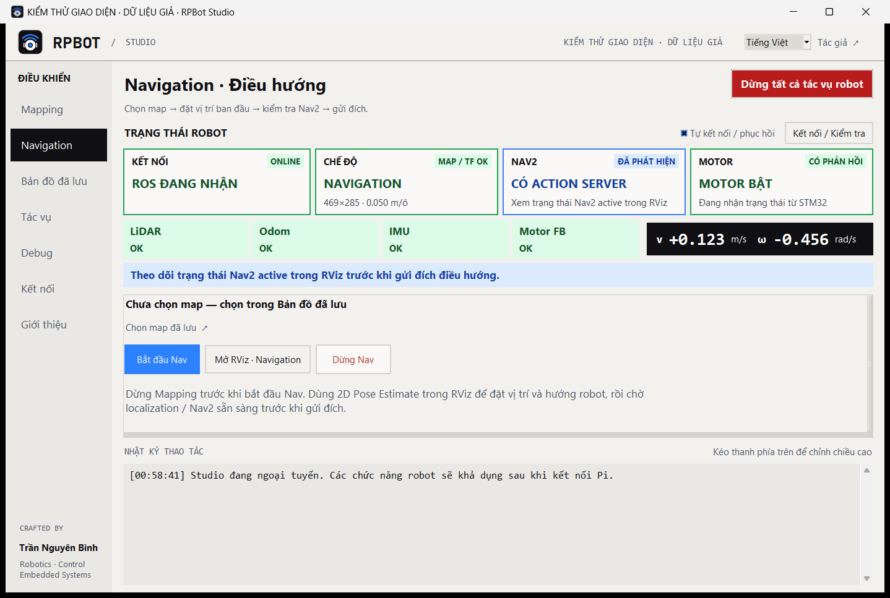
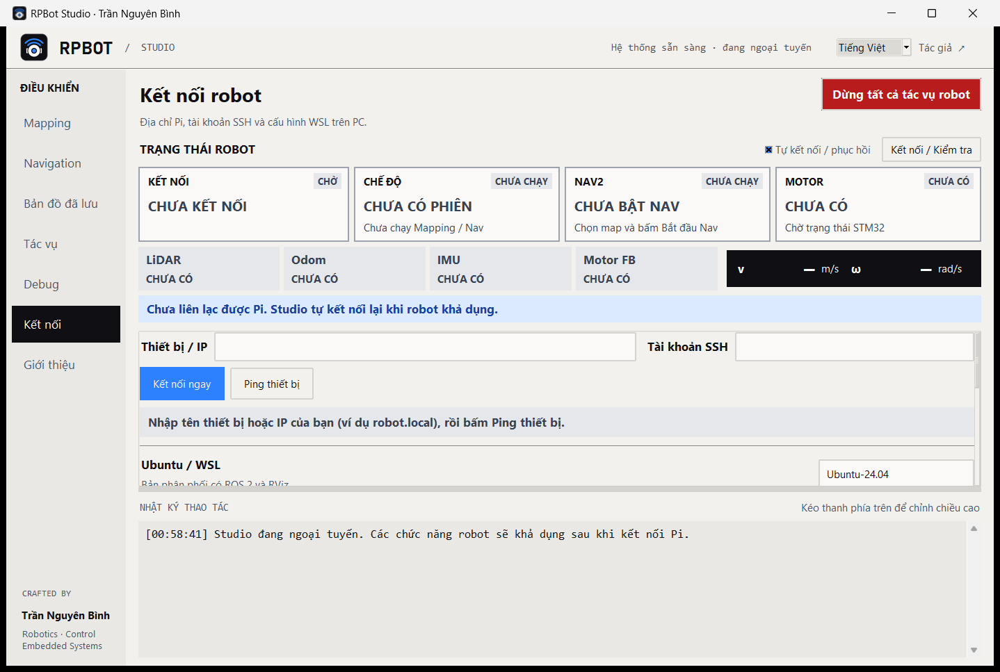
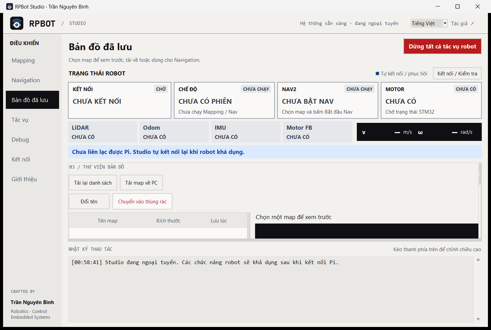

<p align="center"></p>

# RPBot Studio

Ứng dụng desktop để vận hành robot RPBot (Raspberry Pi 5 + STM32H723 + RPLidar,
ROS 2 Jazzy) từ PC: tạo bản đồ (Mapping), điều hướng (Navigation), quản lý bản đồ
đã lưu, theo dõi cảm biến và dừng tác vụ trên robot. Chạy trên **Windows** (ROS
chạy trong WSL) và **Linux** (ROS chạy trực tiếp).



> **English summary.** RPBot Studio is a Tk desktop app for running an RPBot robot
> (Raspberry Pi 5, STM32H723, RPLidar, ROS 2 Jazzy) from a PC. It connects over SSH,
> finds the running Mapping/Navigation session, shows live sensor/Nav2/motor status,
> opens RViz, saves/downloads/renames maps, starts Navigation on a saved map and stops
> robot tasks. It never sends motor or velocity commands. Windows builds run ROS
> through WSL; Linux builds run it directly. The UI switches between Vietnamese and
> English at runtime. Download a build from [Releases](../../releases).

## Mục lục

- [Tính năng](#tính-năng)
- [Yêu cầu](#yêu-cầu)
- [Cài đặt](#cài-đặt)
- [Thiết lập lần đầu](#thiết-lập-lần-đầu)
- [Hướng dẫn sử dụng](#hướng-dẫn-sử-dụng)
- [Tự khởi động mapping trên Pi](#tự-khởi-động-mapping-trên-pi)
- [An toàn](#an-toàn)
- [Xử lý sự cố](#xử-lý-sự-cố)
- [Cấu hình và dữ liệu trên PC](#cấu-hình-và-dữ-liệu-trên-pc)
- [Build từ mã nguồn](#build-từ-mã-nguồn)
- [Kiểm thử](#kiểm-thử)
- [Cấu trúc thư mục](#cấu-trúc-thư-mục)

## Tính năng

- **Tự kết nối**: kiểm tra SSH tới Pi, tìm phiên Mapping/Navigation thật đang chạy,
  tự lấy ROS domain và Fast DDS profile của phiên đó, rồi tự nối lại khi mất mạng.
- **Bảng trạng thái luôn hiển thị**: kết nối, chế độ/map, Nav2, motor, các ô LiDAR /
  Odom / IMU / Motor FB và vận tốc `v`, `ω`, cập nhật khoảng 5 lần/giây. Dữ liệu cũ
  hơn 2 giây được báo riêng, không hiện số đo đã lỗi thời.
- **Mapping**: bắt đầu phiên, mở RViz có sẵn map/LiDAR/robot, lưu map trên Pi,
  tạo map lại (xóa map trong bộ nhớ SLAM, giữ file đã lưu), dừng phiên.
- **Bản đồ đã lưu**: danh sách, ảnh xem trước, tải về PC có kiểm tra checksum,
  đổi tên, chuyển vào thùng rác; không ghi đè file sẵn có.
- **Navigation**: bắt đầu Nav2 với map đã chọn, mở RViz Navigation (Nav2 panel,
  đặt vị trí ban đầu, chọn đích, costmap, đường đi), dừng Nav.
- **Tác vụ**: liệt kê launch/bag đang chạy theo domain, dừng tác vụ đã chọn hoặc
  dừng tất cả; dừng an toàn bằng SIGINT rồi mới SIGTERM, kiểm tra PID trước khi gửi.
- **Debug**: số bản tin, tuổi dữ liệu và trạng thái từng topic; đọc log dịch vụ robot.
- **Ping thiết bị** theo tên `.local` hoặc IP, chạy nền, không khóa giao diện.
- **Tiếng Việt / English** đổi ngay khi đang chạy, lưu cho lần mở sau.

## Yêu cầu

**PC Windows** (bản `RPBotStudio.exe`)

- Windows 10/11 x64.
- WSL 2 với Ubuntu 24.04 và ROS 2 Jazzy có RViz (`sudo apt install ros-jazzy-desktop`).
  Khuyên dùng chế độ mạng *mirrored* của WSL để DDS nhận được dữ liệu từ Pi.
- SSH key trong WSL đăng nhập được vào Pi.

**PC Linux** (gói `RPBotStudio-Linux-x86_64.tar.gz`)

- Ubuntu 24.04 trở lên, x86_64 (file chạy cần glibc 2.39).
- ROS 2 Jazzy có RViz và `ssh`; SSH key đăng nhập được vào Pi.

**Robot (Raspberry Pi)**

- Ubuntu 24.04 + ROS 2 Jazzy, workspace `~/pi5-stm32-slam` đã build, có
  `scripts/run.sh mapping` và `scripts/run.sh navigation`, cùng `slam_toolbox`, Nav2
  và Python `yaml` (PyYAML). Firmware STM32 là
  [Microros_H723_USB](https://github.com/nguyenbinh-shark/Microros_H723_USB).
- Tài khoản SSH có `Linger=yes` nếu dùng tự khởi động mapping (`loginctl enable-linger`).

**Mạng**: PC và Pi cùng mạng LAN. Dùng tên `xxx.local` cần mDNS; nếu mạng chặn
mDNS thì nhập IP. DDS dùng UDP 7400–7649 cho domain 0.

## Cài đặt

### Windows

1. Tải `RPBotStudio.exe` ở trang [Releases](../../releases).
2. Đặt file ở thư mục bất kỳ và nhấp đúp để chạy. File đã chứa Python, Tk và mọi
   tài nguyên; không cần cài Python. Có thể mang riêng file này sang PC khác.
3. (Tùy chọn) Tạo shortcut trên Desktop khi có bản checkout của repo:

   ```powershell
   powershell -ExecutionPolicy Bypass -File .\install_shortcut.ps1
   ```

   Script ưu tiên `dist\RPBotStudio.exe` nếu đã build, nếu không thì dùng Python để
   chạy `launch_rpbot.pyw`.

### Linux

```bash
tar -xzf RPBotStudio-Linux-x86_64.tar.gz
cd RPBotStudio-Linux-x86_64
./install.sh            # cài vào ~/.local/share/rpbot-studio và thêm vào menu ứng dụng
```

Mở **RPBot Studio** trong menu ứng dụng, hoặc chạy thẳng `./RPBotStudio` mà không
cần cài. Gỡ bằng `./install.sh --uninstall`.

### Chạy từ mã nguồn

Cần Python 3.10+ có tkinter (Linux: `sudo apt install python3-tk`). App không cần
thư viện ngoài.

```bash
git clone https://github.com/nguyenbinh-shark/rpbot-studio.git
cd rpbot-studio
python launch_rpbot.pyw        # Linux: python3 launch_rpbot.pyw
```

## Thiết lập lần đầu

1. **SSH key tới Pi.** Trên Windows chạy các lệnh sau trong WSL; trên Linux chạy
   trong terminal thường:

   ```bash
   ssh-keygen -t ed25519            # bỏ qua nếu đã có key
   ssh-copy-id pi@robot.local       # thay bằng tài khoản và tên/IP của Pi
   ssh pi@robot.local true          # đăng nhập một lần để chấp nhận host key
   ```

   Studio dùng SSH `BatchMode`, không lưu mật khẩu và không tự bỏ qua kiểm tra
   host key, nên bước chấp nhận host key phải làm tay một lần.

2. **Mạng WSL (chỉ Windows).** Nếu Studio kết nối SSH được nhưng không nhận dữ liệu
   ROS, kiểm tra firewall Hyper-V cho DDS. Xem cấu hình hiện tại:

   ```powershell
   powershell -File .\configure_network.ps1
   ```

   Tạo rule chỉ cho UDP DDS từ địa chỉ Pi (PowerShell chạy bằng Administrator):

   ```powershell
   powershell -File .\configure_network.ps1 -Apply -PiAddress 192.168.1.50
   ```

3. **Nhập thông tin robot trong Studio.** Mở trang **Kết nối**:

   

   - **Thiết bị / IP**: tên như `robot.local` hoặc IP của Pi.
   - **Tài khoản SSH**: user đăng nhập Pi.
   - Chỉ trên Windows: **Ubuntu / WSL** là tên distro có ROS 2 (mặc định
     `Ubuntu-24.04`), **Tài khoản WSL** là user chạy ROS (để trống để dùng user mặc
     định của WSL).
   - Bấm **Ping thiết bị** để xem IP và số phản hồi (xanh lá: đủ 2 phản hồi; vàng:
     mất gói; đỏ: không phân giải được tên). Không có ping vẫn có thể thử SSH.
   - Bấm **Kết nối ngay**. Cấu hình được lưu trên PC; từ lần sau Studio tự kết nối.

## Hướng dẫn sử dụng

### Bảng trạng thái

Bảng ở đầu cửa sổ luôn hiển thị **Kết nối**, **Chế độ**, **Nav2**, **Motor**, các ô
**LiDAR / Odom / IMU / Motor FB** và vận tốc. Màu luôn đi kèm nhãn chữ:

| Màu | Ý nghĩa |
|---|---|
| Xanh lá | Dữ liệu mới, đã xác nhận |
| Xanh dương | Đã phát hiện (ví dụ có action server Nav2) nhưng chưa xác nhận hoạt động |
| Vàng | Đang chờ hoặc cần xử lý |
| Đỏ | Mất kết nối, dữ liệu cũ hoặc lỗi |
| Xám | Chưa có dữ liệu |

Dòng cảnh báo ngay dưới bảng nêu nguyên nhân và bước nên làm tiếp. Với **Tự kết nối /
phục hồi** bật (mặc định), Studio kiểm tra SSH nền mỗi 5–30 giây và tự nối lại khi
robot khả dụng; không cần bấm **Kết nối / Kiểm tra** trước mỗi thao tác. Đóng Studio
chỉ dừng bộ nhận dữ liệu của Studio, robot và RViz vẫn chạy.

### Mapping: tạo bản đồ

1. Trang **Mapping** → **Bắt đầu mapping**. Nếu Pi đã có đúng một phiên mapping,
   Studio nối vào phiên đó thay vì mở thêm.
2. **Mở RViz · Map** để xem map, LiDAR và robot.
3. Lái robot quét môi trường (bằng tay điều khiển RC; Studio không điều khiển chuyển động).
4. Nhập tên và bấm **Lưu map**. Map được lưu thành `.yaml` + `.pgm` trong
   `~/pi5-stm32-slam/maps/` trên Pi; tên chỉ gồm chữ không dấu, số, `-`, `_`; không ghi đè.
5. Map bị lệch hoặc môi trường đổi: lưu map cũ nếu cần, rồi **Tạo map lại** và xác
   nhận. SLAM bỏ map trong bộ nhớ và dựng lại từ các scan tiếp theo; file đã lưu giữ nguyên.
6. **Dừng tạo map** khi xong. Map chưa lưu trong bộ nhớ sẽ mất.

### Bản đồ đã lưu



- **Tải lại danh sách** để đọc thư viện map trên Pi: ngày lưu, kích thước, độ phân
  giải, ảnh xem trước. Chọn map chỉ để xem hoặc chuẩn bị Navigation.
- **Tải map về PC**: chọn thư mục đích; Studio tạo thư mục con theo tên map chứa
  YAML/PGM, kiểm tra checksum và không ghi đè.
- **Đổi tên** cập nhật cả YAML và PGM; **Chuyển vào thùng rác** (có xác nhận) đưa map
  vào `maps/.trash/` trên Pi. Nếu map đã đổi sau khi tải danh sách, thao tác bị từ
  chối để bạn tải lại danh sách trước.

### Navigation: điều hướng

1. Nếu đang Mapping: lưu map cần giữ, bấm **Dừng tạo map** và chờ dừng xong.
2. Trang **Bản đồ đã lưu** → chọn map.
3. Trang **Navigation** → **Bắt đầu Nav**. Studio kiểm tra map chưa đổi và không mở
   trùng phiên.
4. **Mở RViz · Navigation**, dùng **2D Pose Estimate** đặt vị trí và hướng hiện tại
   của robot. Chờ Nav2 sẵn sàng (ô Nav2 xanh lá) rồi mới chọn đích trong RViz.
5. **Dừng Nav** khi xong; sau đó có thể bắt đầu Mapping lại.

Phiên Navigation do Studio mở chạy dưới dịch vụ `rpbot-navigation.service` trên Pi
với `allow_motor_enable:=false`, không tự chạy lại sau boot.

### Tác vụ và nút dừng

| Nút | Phạm vi |
|---|---|
| **Dừng tạo map** (Mapping) | Các phiên Mapping trong domain đã chọn và tiến trình con |
| **Dừng Nav** (Navigation) | Phiên Navigation trong domain đã chọn và tiến trình con |
| **Dừng tất cả tác vụ robot** (luôn ở góc trên) | Launch robot và ghi/phát bag của dự án trong domain đã chọn |
| **Dừng tác vụ đã chọn** (Tác vụ) | Chỉ các dòng được chọn; giữ Ctrl để chọn nhiều |

Trước khi dừng, Studio liệt kê chế độ/tên bag và PID để bạn xác nhận; hủy thì không
dừng gì. Domain mặc định là 0, đổi được trong trang **Tác vụ**, và tự cập nhật theo
phiên đang kết nối. **Tải lại tác vụ** để xem danh sách mới. Đây là dừng tác vụ ROS;
quyền điều khiển RC và phần cứng vẫn độc lập.

### Debug và nhật ký

- Trang **Debug** có số bản tin, tuổi dữ liệu và trạng thái từng topic
  (`/map`, `/scan`, `/odom`, `/imu/data`, `/motor_fb`, `/motor_status`, TF
  `map → base_footprint`), nút **Đọc log robot** cho dịch vụ Mapping/Navigation và
  **Mở thư mục log PC** để mở thư mục cấu hình và log trên PC.
- **Nhật ký thao tác** ở cuối cửa sổ; kéo thanh phân cách phía trên để đổi chiều cao.

### Ngôn ngữ

Chọn **Tiếng Việt / English** ở thanh trên cùng. Giao diện, trạng thái và hộp thoại
đổi ngay; tên map, đường dẫn và lệnh giữ nguyên. Đổi ngôn ngữ không nối lại SSH/ROS
và không gửi lệnh tới robot.

## Tự khởi động mapping trên Pi

Cài dịch vụ user `rpbot-mapping.service` trên Pi để mapping tự chạy sau mỗi lần boot
(chạy `scripts/run.sh mapping allow_motor_enable:=false`, domain 0):

```bash
python check_connection.py --install-autostart
```

Lệnh chỉ **enable** dịch vụ, không khởi động lại phiên đang chạy, và kiểm tra
`Linger=yes` của tài khoản Pi. Tắt tự chạy (chạy trên Pi):

```bash
systemctl --user disable rpbot-mapping.service
```

`check_connection.py` không kèm tham số chỉ đọc dữ liệu và in báo cáo kết nối;
`--save-map NAME` lưu map của phiên đang chạy.

## An toàn

- Studio **không bao giờ** gửi lệnh bật motor hoặc lệnh vận tốc. Phiên do Studio mở
  luôn có `allow_motor_enable:=false`; việc robot được phép chạy phụ thuộc firmware
  và tay điều khiển RC.
- **Bắt đầu Nav** không gửi goal; đích được chọn trong RViz.
- Các nút dừng chỉ dừng tiến trình ROS/bag của dự án trong domain đã chọn, kiểm tra
  lại PID và thời điểm khởi tạo trước khi gửi tín hiệu; chương trình khác trên Pi
  không bị ảnh hưởng.
- Tác vụ đang chạy dở bị hủy nếu mất mạng giữa chừng và không tự gửi lại khi mạng
  trở lại.

## Xử lý sự cố

| Hiện tượng | Cách xử lý |
|---|---|
| Ping báo đỏ "không phân giải được" | Mạng chặn mDNS: nhập IP của Pi thay cho `xxx.local`. Trên Windows, Studio thử bộ phân giải Windows trước rồi tới `getent` trong WSL. |
| Kết nối SSH lỗi `Permission denied` hoặc `Host key verification failed` | Làm lại bước SSH key ở [Thiết lập lần đầu](#thiết-lập-lần-đầu), đăng nhập tay một lần để chấp nhận host key. |
| SSH được nhưng các ô cảm biến xám/đỏ | DDS bị chặn: kiểm tra firewall (`configure_network.ps1` trên Windows), PC và Pi cùng mạng, WSL ở chế độ mạng mirrored. |
| "Install ros-jazzy-rviz2 on the PC" | Cài `ros-jazzy-desktop` trong WSL (Windows) hoặc trên máy Linux. |
| "Build pi5-stm32-slam on the Pi first" | Workspace `~/pi5-stm32-slam` trên Pi chưa có hoặc chưa build. |
| Ô Nav2 xanh dương nhưng robot không đi | Action server có rồi nhưng Nav2 chưa active: đặt **2D Pose Estimate** trong RViz và chờ. |
| Dữ liệu báo "cũ" liên tục | Bộ nhận trên PC tự mở lại sau 8 giây không có dữ liệu; nếu vẫn lỗi, xem trang **Debug** và log robot. |
| Bản Linux không mở trên Ubuntu cũ | File chạy cần glibc 2.39 (Ubuntu 24.04+); trên bản cũ hơn hãy chạy từ mã nguồn. |

## Cấu hình và dữ liệu trên PC

| | Windows | Linux |
|---|---|---|
| Cấu hình, log | `%LOCALAPPDATA%\RPBotConsole\` | `~/.local/state/RPBotConsole/` |
| ROS chạy ở | WSL (`wsl.exe -d <distro> -u <user>`) | Trực tiếp trên máy |

Cấu hình giữ nguyên khi thay bản app mới. Bản build chỉ chứa mã và tài nguyên của app,
không kèm cấu hình PC, SSH key, log hay bản đồ.

## Build từ mã nguồn

**Windows** (cần Python 3.10+):

```powershell
python -m pip install -r requirements-build.txt
powershell -ExecutionPolicy Bypass -File .\build_exe.ps1     # ra dist\RPBotStudio.exe
python -X utf8 tests\smoke_exe.py --wsl                       # chạy thử EXE thật, không liên lạc robot
```

**Linux** (Ubuntu 24.04, máy thật hoặc WSL):

```bash
sudo apt install python3-tk python3-venv binutils
bash packaging/linux/build.sh      # ra dist/linux/RPBotStudio-Linux-x86_64.tar.gz
```

Script tạo môi trường build ở `~/.cache/rpbot-build-venv`. Hai bản dùng chung
`RPBotStudio.spec`, chỉ đóng gói danh sách file được liệt kê trong đó.

**Icon**: vẽ bằng code trong `tools/make_icon.py` (cần Pillow); sửa script rồi chạy
lại `python tools/make_icon.py`.

## Kiểm thử

```bash
python -m unittest discover -s tests -v       # unit test, không cần robot (Windows và Linux)
python tests/preview_studio.py                # Windows: chụp cả 7 trang ở 2 kích thước, offline
python tests/preview_studio.py --states       # thêm ảnh các trạng thái với dữ liệu giả có ghi nhãn
python tests/smoke_language_ui.py             # đổi ngôn ngữ trực tiếp trên mọi trang
```

Các bài smoke/preview chạy với thư mục cấu hình tạm, không kết nối Pi. Bài
`check_connection.py` và `tests/smoke_gui.py` cần robot thật và chỉ đọc dữ liệu
(trừ khi truyền `--save-map`).

## Cấu trúc thư mục

```text
launch_rpbot.pyw        điểm khởi chạy app
rpbot_console.py        logic kết nối, SSH/WSL, phiên ROS, thao tác robot
console_layout.py       bố cục giao diện, các trang
status_dashboard.py     bảng trạng thái
robot_status.py         tóm tắt trạng thái từ dữ liệu ROS
ros_session.py/.sh      node nhận dữ liệu và mở RViz trên PC (chạy với ROS)
remote_ops.py           chạy trên Pi qua SSH: phiên, map, dịch vụ, dừng tác vụ
map_library.py          thư viện map trên Pi
robot_tasks.py          tìm và dừng tác vụ ROS trên Pi
ui_language.py          lớp đổi ngôn ngữ; ui_translations.py là bảng dịch
*.rviz                  cấu hình RViz Mapping / Navigation
assets/                 icon; tools/make_icon.py vẽ lại icon
packaging/linux/        build và cài bản Linux
tests/                  unit test, smoke test giao diện và EXE
```

## Tác giả

Trần Nguyên Bình · [nguyenbinh-shark.github.io](https://nguyenbinh-shark.github.io) ·
[GitHub](https://github.com/nguyenbinh-shark)

App cùng bộ: [DAPLink Flasher](https://github.com/nguyenbinh-shark/daplink-flasher),
nạp firmware STM32H723 qua mạch nạp CMSIS-DAP không dây.
